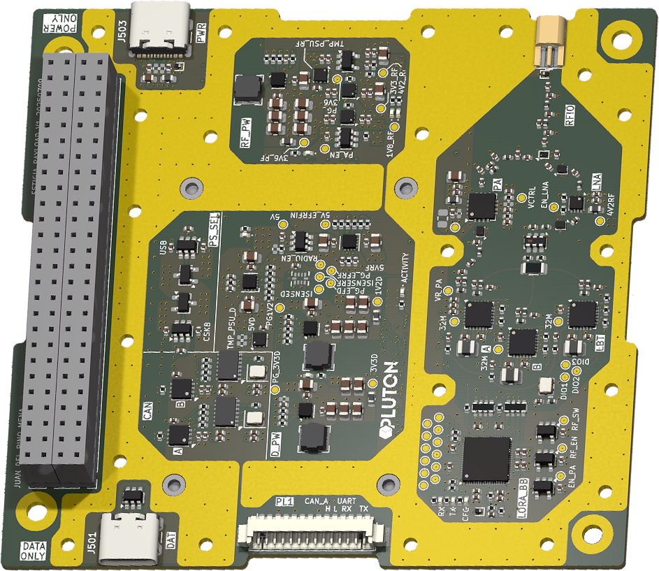
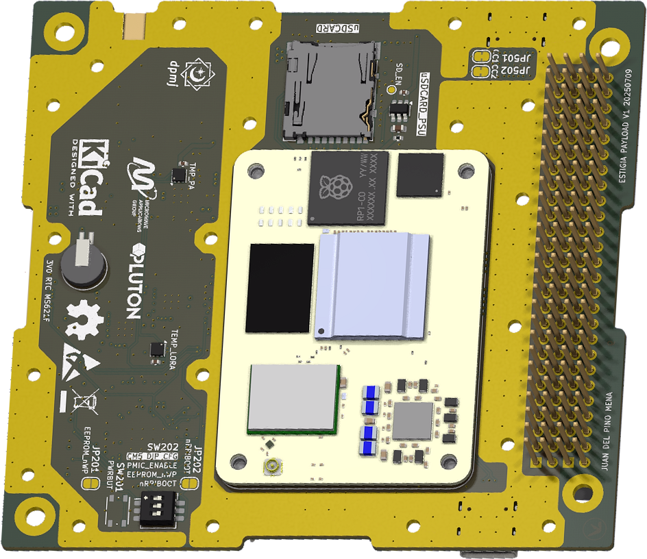

# Hardware design of a LoRa Gateway and in-orbit computing payload for CubeSat.

This repository contains the hardware design files from my second Master's Thesis in Telecommunications Engineering at the Polytechnic University of Valencia, Spain, 2024. The payload consists of a CubeSat-PC/104 form factor motherboard that integrates LoRa gateway hardware and a Raspberry Pi Compute Module 5 for in-orbit computing tasks. 

This project is a continuation of my previous master's thesis: [Hardware design of a LoRa Gateway payload for CubeSat.](https://github.com/dpmj/masters-thesis-lora-gateway-cubesat-payload-pcb/)

Third-party desing elements included in this repository are subject to the copyright of their respective owners.

```bibtex
@phdthesis{dpmj-master-thesis-2025,
    author = {{Del Pino Mena}, Juan},
    title = {Development of a {CubeSat} payload for in-orbit computing and {LoRa} communications},
    school = {Universitat Politècnica de València},
    year = {2025},
    month = {9},
    address = {València, Spain},
    type = {Master's thesis},
    doi = {https://doi.org/10.5281/zenodo.16641815}
}
```






